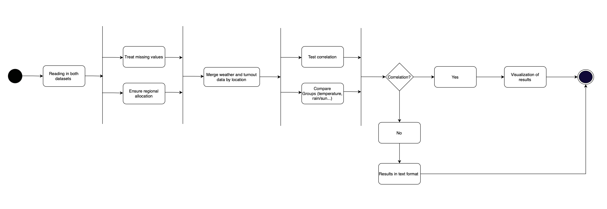

# Requirement Specification 

## Functional Requirements 

We want to analyze what influence weather conditions have on voter turnout in Germany. 

### Data Analyse Workflow
The following Activity Diagram shows an abstract description of the data analysis workflow: 

For each node in the Activity Diagram, the following table lists the  input, output, and implementation (using packages or own implementation).

## Non-Functional Requirements 

### Compatibility 
- The system must be compatible with Windows, macOS, Linux. 
- Python version ≥ 3.10 is required.

### Architecture 
- the system must be clearly divided into two parts
    - **Analysis Part**: Responsable for data processing and calculations. 
    - **Visualization Part**: Presents analysis results in a user-friendly format. 

### Data Handling 
- Processed data is handled exclusively on the user’s local machine. No processed data is stored or transmitted to external servers.
- No storage of personal informations. 

### Useability 
- Analysis results must be presented understandable to end users.
- The system will be made publicly available.

